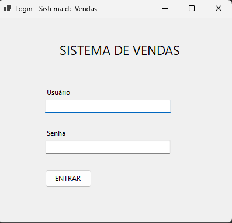
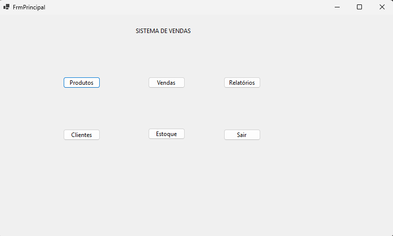
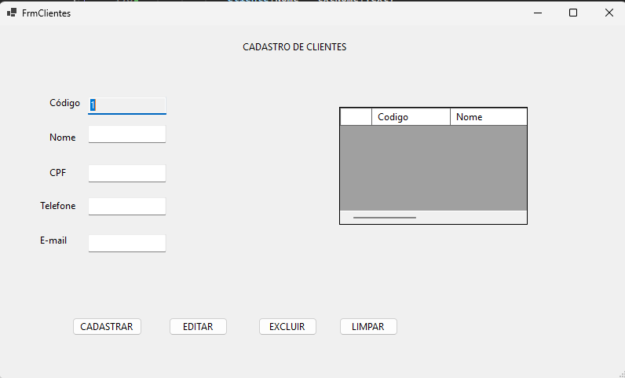
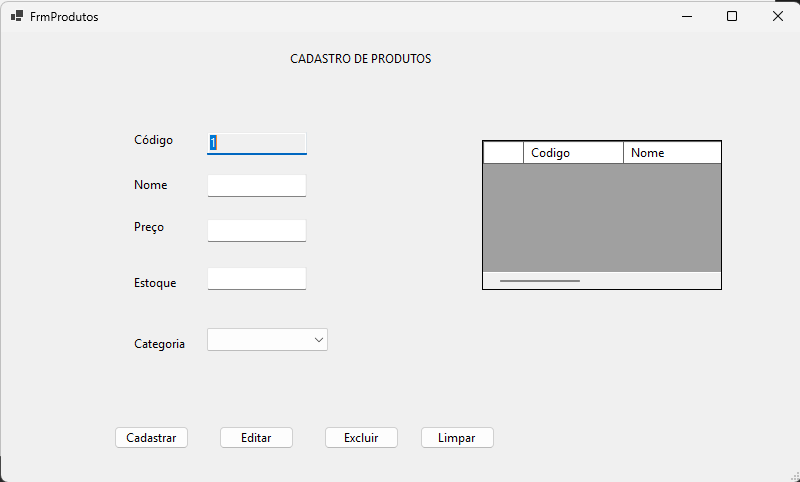
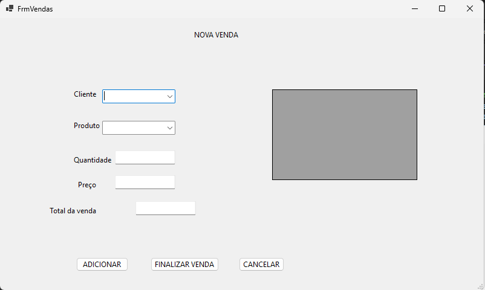

# SistemaVendas

Sistema desktop de gerenciamento de vendas desenvolvido em C# e .NET, criado como projeto de portfólio para aplicação prática de conceitos de programação, orientação a objetos e desenvolvimento de aplicações Windows Forms.

> 🚧 Projeto em desenvolvimento — novas funcionalidades e melhorias serão adicionadas continuamente.

## 📋 Sobre o projeto

O SistemaVendas tem como objetivo oferecer uma solução simples para gerenciamento de clientes, produtos e vendas em uma aplicação desktop.

O projeto está sendo desenvolvido utilizando C# e Windows Forms, com foco em boas práticas de programação, organização do código, validações e construção de uma aplicação completa do início ao fim.

## 🚀 Funcionalidades

### 🔐 Login
- Tela de autenticação do sistema
- Validação de usuário e senha
- Acesso à tela principal após autenticação

### 👥 Clientes
- Cadastro de clientes
- Edição de clientes
- Exclusão de clientes
- Geração automática de código
- Máscara de CPF
- Validação de CPF
- Validação de telefone
- Validação de e-mail

### 📦 Produtos
- Cadastro de produtos
- Edição de produtos
- Exclusão de produtos
- Geração automática de código
- Controle de preço
- Controle de estoque
- Categorias de produtos

### 🛒 Vendas
- Seleção de produtos
- Preenchimento automático do preço
- Cálculo do total dos itens
- Cálculo do valor total da venda
- Cancelamento da venda

### 📊 Outras funcionalidades
- Controle de estoque
- Histórico de vendas
- Relatórios

## 🛠️ Tecnologias utilizadas

- **C#**
- **.NET**
- **Windows Forms**
- **Visual Studio**
- **Git**
- **GitHub**

## 🖥️ Telas do sistema

### 🔐 Login



### 🏠 Tela Principal



### 👥 Clientes



### 📦 Produtos



### 🛒 Vendas



## 🧠 Conceitos aplicados

Durante o desenvolvimento do projeto estão sendo aplicados conceitos como:

- Programação Orientada a Objetos (POO)
- Classes e objetos
- Encapsulamento
- Listas e coleções
- Métodos
- Estruturas condicionais
- Laços de repetição
- Validação de dados
- Manipulação de eventos
- Windows Forms
- DataGridView
- Organização de código
- Controle de versão com Git

## 📁 Estrutura do projeto

```text
SistemaVendas/
│
├── SistemaVendas/
│   ├── FrmLogin.cs
│   ├── FrmPrincipal.cs
│   ├── FrmClientes.cs
│   ├── FrmProdutos.cs
│   ├── FrmVendas.cs
│   ├── DadosSistema.cs
│   └── ...
│
├── SistemaVendas.slnx
├── .gitignore
└── README.md

## 🎯 Objetivo profissional

Este projeto faz parte do meu portfólio de desenvolvimento em C# e .NET.

O objetivo é demonstrar, na prática, a aplicação de conceitos de programação, orientação a objetos, desenvolvimento de aplicações Windows Forms, validação de dados e controle de versão com Git e GitHub.

O projeto está em desenvolvimento contínuo, com novas funcionalidades e melhorias sendo implementadas conforme o aprendizado e a evolução da aplicação.